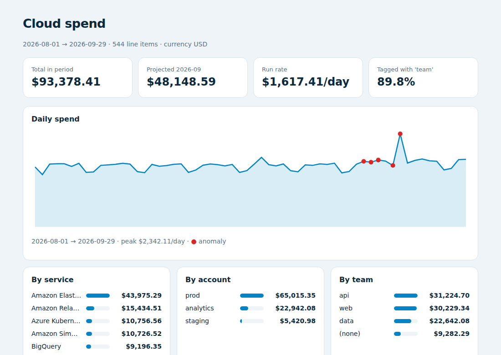

<p align="center">
  <picture>
    <source media="(prefers-color-scheme: dark)" srcset="assets/logo-dark.svg">
    
  </picture>
</p>

<p align="center">
  <a href="https://github.com/yagodejesus/cloudtally/actions/workflows/ci.yml"></a>
  <a href="https://pypi.org/project/cloudtally/"></a>
  <a href="https://pypi.org/project/cloudtally/"></a>
  <a href="LICENSE"></a>
</p>

**FinOps in one command.** Point it at a cloud cost export and get spend breakdowns, tag coverage, anomalies, top movers, a month-end forecast and budget checks — for AWS, Azure, Google Cloud and any provider that speaks [FOCUS](https://focus.finops.org/).

> 🇧🇷 *Relatórios de custo de nuvem a partir das exportações padrão FOCUS (AWS, Azure, Google Cloud) e do CUR da AWS: gasto por serviço, conta e tag, quanto está sem tag, picos anormais, maiores variações, previsão do fim do mês e orçamentos.*

```bash
pip install cloudtally
cloudtally focus_export.csv --tag team --budget total=40000 --html report.html
```

<p align="center"></p>

```text
Cloud spend 2026-08-01 → 2026-09-29: $93,378.41
  2026-09 month-to-date $46,531.18 · run rate $1,617.41/day · projected $48,148.59

Tag 'team': 89.8% of spend tagged ($9,582.29 untagged)

Anomalies
  2026-09-20  BigQuery                                $983.34 (expected $143.29, +$840.05)
  2026-09-19  Amazon Relational Database Service      $354.39 (expected $244.12, +$110.27)

Budget total: $46,531.18 spent, $48,148.59 projected of $40,000.00 (120%) ⚠ over
```

(Numbers from the synthetic sample in [`examples/`](examples/), which includes a runaway BigQuery query and a database that was scaled up mid-month.)

## Why

Cloud bills are the second-largest cost for many software companies, and the first questions are always the same: *what changed, who owns it, and where will we land this month?* Commercial FinOps platforms answer them for a percentage of your spend. Since 2024 AWS, Azure, Google Cloud and Oracle export costs in the same open format — **FOCUS** — so the analysis can be a small, auditable, open-source tool that runs in CI or a cron job.

## What it reports

| Analysis | How |
|---|---|
| **Breakdowns** | by service, category, provider, region, account, resource or any tag (`tag:team`) |
| **Tag coverage** | % of usage spend carrying a tag, and the largest untagged resources — your tagging to-do list |
| **Anomalies** | daily spikes per service using a robust z-score (median and MAD of the previous 14 days), with dollar impact; purchases, credits and taxes are excluded |
| **Top movers** | the biggest changes between the last N days and the N before |
| **Forecast** | month-to-date plus the recent daily run rate, through month end |
| **Budgets** | `total=50000`, `tag:team=data=8000`, `service=BigQuery=3000` — spent, projected and over/under |

Reports come as text, Markdown (Slack, PR comments, `$GITHUB_STEP_SUMMARY`), JSON or a single-file HTML page that works offline.

## Inputs

- **FOCUS 1.x** exports from AWS Data Exports, Azure Cost Management, Google Cloud billing, Oracle Cloud and others (`EffectiveCost`, falling back to `BilledCost`; `Tags` as JSON).
- **Legacy AWS CUR** (`lineItem/UnblendedCost`, `resourceTags/user:*` columns) — detected automatically.
- `.csv` or `.csv.gz`, streamed with the standard library. No pandas, no cloud credentials.

## Python

```python
import cloudtally
from datetime import date

costs = cloudtally.read("focus_export.csv.gz")

costs.by("service", top=5)
costs.by("tag:team")
costs.tag_coverage(["team", "env"])            # {'team': (tagged, untagged, 89.8), ...}
costs.untagged("team", dim="resource")
costs.anomalies(dim="service", threshold=3.5)  # [Anomaly(day, key, cost, expected, impact, score)]
costs.movers(days=7)
costs.forecast()                               # Forecast(month='2026-09', projected=Decimal(...))
costs.budgets({"total": 40000, "tag:team=data": 10000})
costs.filter(since=date(2026, 9, 1), provider="AWS", tag_env="prod")

open("report.html", "w").write(cloudtally.html_report(costs, tag_keys=["team"]))
```

All money is `Decimal` — no floating-point cents drifting in your totals.

## In CI or cron

```bash
cloudtally export.csv.gz --markdown --tag team >> "$GITHUB_STEP_SUMMARY"
cloudtally export.csv.gz --budget total=50000 --fail-on budget --fail-on anomaly   # exit 1 → alert
```

## Development

```bash
git clone https://github.com/yagodejesus/cloudtally && cd cloudtally
pip install -e ".[dev]"
python examples/make_sample.py   # regenerate the synthetic sample
pytest && ruff check .
```

## License

MIT © Yago de Jesus Martins
